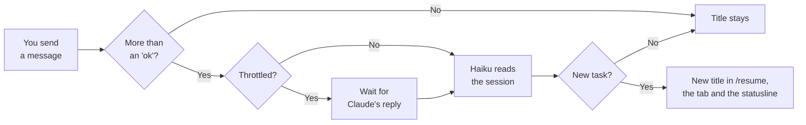

# Live Title

**Claude Code session titles that keep up with your work.**

Claude Code names a session after your first message and keeps that name for good. Live Title renames the session whenever the work moves on to something new, so your terminal tabs, your statusline and `/resume` always tell you what each session is doing now.

[](https://github.com/macworld/claude-live-title/releases)
[](LICENSE)
[](https://github.com/macworld/claude-live-title/stargazers)

English | [中文](README_ZH.md)


## Why

Sessions drift. You open one to fix a login bug, and an hour later you're reworking how refresh tokens are issued, but the session is still named after the bug. With a few of those open in tabs, you end up guessing which one is which.

| You say | Claude Code's title | Live Title |
|---|---|---|
| users get a 401 as soon as their access token expires… | Access token expiry returns 401 | Fix 401 after token expiry |
| let's switch to rotating refresh tokens with reuse detection | Access token expiry returns 401 | Rotating refresh tokens |
| sounds good, go ahead | Access token expiry returns 401 | Rotating refresh tokens |

The title changes when the task changes, and stays put when you just say "go ahead". Every title in this table and in the demo is real output from Claude Code and Live Title for those messages. The statusline in the demo is [Claude HUD](#with-claude-hud).

## Features

- **Follows the task, not the first message.** Start on a bug, move on to a redesign, and the title moves with you. Follow-ups, fixes and "ok, go ahead" never reword it.
- **Waits for a real task.** A "hi" or a test message leaves the session unnamed until you ask for something.
- **Your naming format.** Ticket IDs up front, `fix:` / `feat:` prefixes, whatever your team uses. Describe it in plain words, for every session or [per project](#naming-format).
- **Any language.** Titles come in the language you write in, or one you choose.
- **Only listens to you.** Background task notifications, subagent results and compaction summaries don't count, and a session you named with `/rename` or `--name` keeps that name.
- **Never in your way.** Titles are written in the background by one small Haiku call, about $0.0005 each. When you hit a usage limit or the API fails, nothing is written and the plugin pauses.

## Install

In Claude Code, run:

```
/plugin marketplace add macworld/claude-live-title
/plugin install live-title@claude-live-title
```

Then restart Claude Code. Hooks load only at startup, so `/reload-plugins` isn't enough. That's all: it works without any configuration.

The plugin is called `live-title`. The repo and the marketplace keep its old name, `claude-live-title`.

**From Anthropic's community directory.** Live Title is also listed in [`claude-plugins-community`](https://github.com/anthropics/claude-plugins-community), under its old name. New versions reach the directory only after Anthropic's review, so it can be a few versions behind this repo.

```
/plugin marketplace add anthropics/claude-plugins-community
/plugin install claude-live-title@claude-community
```

**Requirements:** Claude Code 2.1 or later, `jq`, and Linux or macOS. On Windows, use WSL.

<details>
<summary><strong>Upgrading from <code>claude-live-title</code> (before 2.0)</strong></summary>

The plugin was renamed from `claude-live-title` to `live-title` in 2.0. Remove the old one with `--keep-data`, install the new one, then restart. Your config and session titles carry over.

```bash
claude plugin uninstall claude-live-title@claude-live-title --keep-data
claude plugin marketplace update claude-live-title
claude plugin install live-title@claude-live-title
```

If you installed from the community directory, there's nothing to reinstall: the entry there keeps the old name.

</details>

<details>
<summary><strong>Linux: install fails with <code>EXDEV: cross-device link not permitted</code></strong></summary>

On many Linux setups `/tmp` is a separate tmpfs filesystem, which breaks plugin installs. Point `TMPDIR` at your home directory when you start Claude Code:

```bash
mkdir -p ~/.cache/tmp && TMPDIR=~/.cache/tmp claude
```

Then run the install commands in that session.

</details>

## Where Titles Show Up

- **`/resume`** lists past sessions by title.
- **The terminal tab.** Claude Code sets the terminal title to the session title (in tmux, the pane title). Nothing to set up.
- **Your statusline.** Claude Code passes the title to statusline commands as `session_name`. The smallest statusline that shows it, in `~/.claude/settings.json`:

  ```json
  {
    "statusLine": {
      "type": "command",
      "command": "jq -r '.session_name // empty'"
    }
  }
  ```

- **[Claude HUD](#with-claude-hud)**, if you use it.

The tab and the statusline pick up a new title when you send your next message, because that's the only moment Claude Code accepts a title from a plugin. Until the plugin's first title arrives, they show Claude Code's own. After `/clear`, your first message stands in as the title until the generated one arrives with your next message.

### With Claude HUD

[Claude HUD](https://github.com/jarrodwatts/claude-hud) can show the session title in its statusline, as in the demo above. The option is off by default.

1. Install Claude HUD:

   ```
   /plugin marketplace add jarrodwatts/claude-hud
   /plugin install claude-hud
   ```

2. Run `/claude-hud:configure` and turn on `showSessionName`. Or set it yourself in `~/.claude/plugins/claude-hud/config.json`:

   ```json
   {
     "display": {
       "showSessionName": true
     }
   }
   ```

3. Start a new session. The statusline now shows the title and follows it as the work moves on.

## Configuration

Everything is optional, and most people only ever set `language` or `style`. Run `/live-title:config` to view or change settings by just asking, or edit `config.json` in the plugin's data directory. The directory is named after the marketplace you installed from, for example:

```
~/.claude/plugins/data/live-title-claude-live-title/config.json
```

| Setting | Default | What it does |
|---|---|---|
| `language` | `"auto"` | Title language. `"auto"` uses the language of your messages, even when the code and Claude's replies are in English. Or pick one: `"en"`, `"zh"`, `"ja"`, `"ko"`, … |
| `style` | `""` | Your naming rules, in plain words. See [Naming format](#naming-format). |
| `maxLength` | `30` | Maximum title width in columns. CJK characters count as 2. |
| `liveUpdate` | `true` | `false` names each session once and never renames it. |

A config only needs the settings you change. For example, to always get English titles:

```json
{
  "language": "en"
}
```

<details>
<summary><strong>Advanced settings</strong></summary>

| Setting | Default | What it does |
|---|---|---|
| `model` | `"haiku"` | The model that writes titles. |
| `throttleInterval` | `60` | Minimum seconds between updates while you're sending messages. Anything skipped is caught up after Claude replies. |
| `contextMessages` | `{"head": 1, "tail": 5}` | How many of your first and most recent messages the model sees. |
| `debug` | `false` | Write a debug log to the plugin's data directory. It names any setting the plugin doesn't recognize. |

</details>

### Naming Format

By default a title is a short plain phrase. To give titles a format, describe it in `style`:

```json
{
  "style": "Start the title with the ticket ID in square brackets, like [PROJ-123], when the user mentions one."
}
```

With that rule, `PROJ-1423: the login form accepts an empty password, fix it` gets the title `[PROJ-1423] Fix empty password`.

Another rule that works well:

```
Begin the title with one of feat:, fix:, docs:, refactor:, chore: and then a short lowercase summary.
```

To set rules for one project, write them in `.claude/live-title.md` at the project root. That file replaces `style` for the project's sessions, and you can commit it so your whole team gets the same format. Rules can be in any language, up to 1000 characters, and `maxLength` still applies.

## How It Works



When you send a message, Haiku gets a short summary of the session: the current title, your first message, your latest messages and an excerpt of Claude's last reply. It keeps the title while you're still working toward the same goal and writes a new one when you've moved on. The title is written in the background while Claude replies, at most once per `throttleInterval`; anything skipped is caught up after the reply. The model never gets tools and treats the conversation as material to title, not as instructions, so a prompt you paste into the session can't steer it.

<details>
<summary><strong>The details</strong></summary>

Live Title runs on three hooks:

1. **When you send a message** (UserPromptSubmit, async). A new title is written while Claude works on the reply, at most once per `throttleInterval`.
2. **After each reply** (Stop, async). Names the session if it has no title yet, catches up on messages the throttle skipped, re-checks the title when the last check is more than 15 minutes old so long autonomous runs stay current, and puts the latest title back if Claude Code wrote an older one.
3. **Title sync** (UserPromptSubmit, sync). Claude Code keeps its own copy of the title: it shows that copy in the tab and the statusline and writes it back to the transcript. This hook hands Claude Code the latest title through the official `sessionTitle` field so the two stay in step. It makes no model call and takes about 20 ms.

The model sees:

- **`CURRENT_TITLE`**: the title shown now. It's kept unless the goal has changed, so titles don't churn.
- **`FIRST`**: your first message, which gives short follow-ups their meaning.
- **`EARLIER`**: your recent messages before the latest one (up to `contextMessages.tail`).
- **`LATEST`**: your latest message, the strongest signal.
- **`CLAUDE`**: an excerpt of Claude's latest reply, as background.

Long messages keep only their start and end. Claude's reply is cleaned first: code blocks, inline code, stack frames and shell prompt lines are removed (rules in `hooks/lib/sanitize-line-rules.tsv`), and the excerpt is dropped if little text is left. When there's no task yet (a greeting, a test message, small talk) the model answers `SKIP` and nothing is written. The call runs through `claude -p` with no tools and no saved session, and one run spends at most 60 seconds on model calls. If a title comes back wider than `maxLength`, up to two more calls ask for a shorter one. The result is written to the transcript as a `custom-title` entry.

</details>

## FAQ

**Does it slow Claude Code down?**
No. Titles are generated in the background. The only hook that runs in line makes no model call and takes about 20 ms.

**What does it cost?**
Each title is one Haiku call of about 1.6K input tokens, roughly $0.0005 at API prices. It goes through the same login as Claude Code, so on a Pro or Max plan it counts toward your plan's usage like any other request.

**What leaves my machine?**
Only the title call itself, which goes to Anthropic through `claude -p` like any Claude Code request. The plugin collects no analytics. See the [Privacy Policy](PRIVACY.md).

## Troubleshooting

**A session has no title.**
A greeting or a test message gets no title. The session is named once you ask for something.

**No titles show up at all.**
1. Check that the plugin is installed and enabled: `live-title` should be in your enabled plugins.
2. Restart Claude Code after installing or updating. Hooks only load at startup.
3. Set `"debug": true` in your config and check `~/.claude/plugins/data/live-title-*/debug.log`.

**A session stopped updating.**
- If you renamed it (`/rename`, `--name`), the plugin leaves your name alone on purpose.
- After a usage-limit error the plugin pauses for 10 minutes (2 minutes after other errors), so it doesn't keep hitting the limit.

**Titles are in the wrong language.**
Set `language` in your config.

**Got a bad title? Help fix it.**
With `"debug": true`, every generated title adds an event to the debug log with the exact input the model saw. Run `bin/promote-fixture.sh <slug>` to turn the latest one into a regression fixture under `tests/fixtures/transcripts/`, then open an issue or PR with it.

## Development

```bash
git clone https://github.com/macworld/claude-live-title
cd claude-live-title

# Load the plugin straight from your working copy
claude --plugin-dir .
```

`--plugin-dir` skips the install and the plugin cache. Hook changes need a session restart; `/reload-plugins` picks up command and skill changes.

Run the tests:

```bash
for t in tests/test-*.sh; do bash "$t"; done

# Also check the fixtures against the real model (about one cent per run)
RUN_LIVE=1 bash tests/test-fixtures.sh

# Run each fixture 4 times to catch titles that only go wrong sometimes
RUN_LIVE=1 SAMPLES=4 bash tests/test-fixtures.sh
```

## More

- [Changelog](CHANGELOG.md): release notes and version history
- [Privacy Policy](PRIVACY.md): what runs locally and what leaves your machine

## License

MIT
