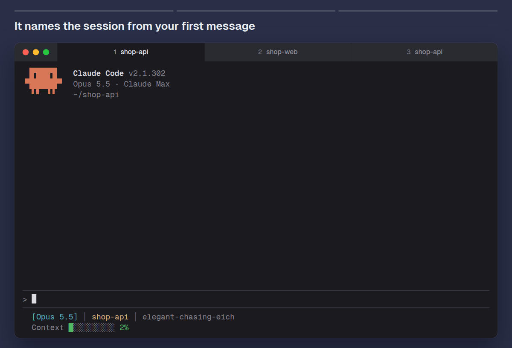
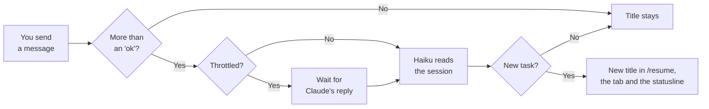

# Live Title

Live Title is a Claude Code plugin that names your sessions and renames them when the task changes. The title shows up in the terminal tab, the statusline and `/resume`.

[](https://github.com/macworld/claude-live-title/releases)
[](LICENSE)
[](https://github.com/macworld/claude-live-title/stargazers)

English | [中文](README_ZH.md)



## Why

1. **You have several sessions open.** When each session works on a different task, it's easy to forget what a given session is doing, especially after a break or when you switch between them. The title should tell you.
2. **The task changes during a session.** Over a long session, the topic and the goal often shift. Claude Code titles a session once, from your first message, and never updates it, so the title falls out of date. Live Title updates it when the task changes.

For example, this session starts with a bug report and moves on to changing how refresh tokens work:

| Your message | Claude Code's title | Live Title |
|---|---|---|
| users get a 401 as soon as their access token expires… | Access token expiry returns 401 | Fix 401 after token expiry |
| let's switch to rotating refresh tokens with reuse detection | Access token expiry returns 401 | Rotating refresh tokens |
| sounds good, go ahead | Access token expiry returns 401 | Rotating refresh tokens |

The second message changes the task, so the title changes. The third only confirms it, so the title stays. The titles in the table and in the demo are actual output. The statusline in the demo is [Claude HUD](#with-claude-hud).

## Features

- Keeps the title while you work toward the same goal. Follow-up questions, small fixes and replies like "go ahead" don't change it.
- Waits for a task. A greeting or a test message doesn't get a title.
- Custom naming format, described in plain words: ticket IDs first, `fix:` / `feat:` prefixes, or whatever your team uses. Set it globally or [per project](#naming-format).
- Titles are in the language of your messages, or in a language you set.
- Only your own messages count. Background task notifications, subagent results and compaction summaries are ignored. A session you named with `/rename` or `--name` keeps its name.
- Runs in the background and doesn't slow Claude Code down. Each title is one Haiku call, about $0.0005. If you hit a usage limit or the API returns an error, no title is written and the plugin pauses for a few minutes.

## Install

Run these in Claude Code:

```
/plugin marketplace add macworld/claude-live-title
/plugin install live-title@claude-live-title
```

Then restart Claude Code. Hooks are loaded only at startup, so `/reload-plugins` is not enough. No configuration is needed.

The plugin is named `live-title`. The repo and the marketplace still use its old name, `claude-live-title`.

You can also install it from Anthropic's community directory, [`claude-plugins-community`](https://github.com/anthropics/claude-plugins-community), where it is listed under the old name. New versions reach the directory only after Anthropic reviews them, so it may be a few versions behind this repo.

```
/plugin marketplace add anthropics/claude-plugins-community
/plugin install claude-live-title@claude-community
```

**Requirements:** Claude Code 2.1 or later, `jq`, and Linux or macOS. On Windows, use WSL.

<details>
<summary><strong>Upgrading from <code>claude-live-title</code> (before 2.0)</strong></summary>

The plugin was renamed from `claude-live-title` to `live-title` in 2.0. Uninstall the old plugin with `--keep-data`, install the new one, then restart. Your config and session titles are kept.

```bash
claude plugin uninstall claude-live-title@claude-live-title --keep-data
claude plugin marketplace update claude-live-title
claude plugin install live-title@claude-live-title
```

If you installed from the community directory, you don't need to do anything: the entry there still uses the old name.

</details>

<details>
<summary><strong>Linux: install fails with <code>EXDEV: cross-device link not permitted</code></strong></summary>

On many Linux systems `/tmp` is a separate tmpfs filesystem, and plugin installs fail because of it. Start Claude Code with `TMPDIR` pointing to a directory under your home:

```bash
mkdir -p ~/.cache/tmp && TMPDIR=~/.cache/tmp claude
```

Then run the install commands in that session.

</details>

## Where Titles Show Up

- **`/resume`** lists past sessions by title.
- **Terminal tab.** Claude Code sets the terminal title to the session title (the pane title in tmux). No setup needed.
- **Statusline.** Claude Code passes the title to the statusline command as `session_name`. A minimal statusline that shows only the title, in `~/.claude/settings.json`:

  ```json
  {
    "statusLine": {
      "type": "command",
      "command": "jq -r '.session_name // empty'"
    }
  }
  ```

- **[Claude HUD](#with-claude-hud)**, if you use it.

The tab and the statusline switch to a new title when you send your next message, because that is the only point at which Claude Code accepts a title from a plugin. Until the plugin's first title arrives, they show Claude Code's own title. After `/clear`, they show your first message as a temporary title, which is replaced by the generated title when you send your next message.

### With Claude HUD

[Claude HUD](https://github.com/jarrodwatts/claude-hud) can show the session title in its statusline, as in the demo above. This option is off by default.

1. Install Claude HUD:

   ```
   /plugin marketplace add jarrodwatts/claude-hud
   /plugin install claude-hud
   ```

2. Run `/claude-hud:configure` and turn on `showSessionName`, or set it in `~/.claude/plugins/claude-hud/config.json`:

   ```json
   {
     "display": {
       "showSessionName": true
     }
   }
   ```

3. Start a new session. The statusline now shows the session title.

## Configuration

All settings are optional. To view or change them, run `/live-title:config` and say what you want, or edit `config.json` in the plugin's data directory. The directory name depends on the marketplace you installed from, for example:

```
~/.claude/plugins/data/live-title-claude-live-title/config.json
```

| Setting | Default | What it does |
|---|---|---|
| `language` | `"auto"` | Title language. `"auto"` uses the language of your messages, even when the code and Claude's replies are in English. Or set one: `"en"`, `"zh"`, `"ja"`, `"ko"`, … |
| `style` | `""` | Your naming rules, in plain words. See [Naming format](#naming-format). |
| `maxLength` | `30` | Maximum title width in columns. CJK characters count as 2. |
| `liveUpdate` | `true` | With `false`, each session is named once and never renamed. |

The config file only needs the settings you change. For example, to always get English titles:

```json
{
  "language": "en"
}
```

<details>
<summary><strong>Advanced settings</strong></summary>

| Setting | Default | What it does |
|---|---|---|
| `model` | `"haiku"` | The model that writes titles. |
| `throttleInterval` | `60` | Minimum seconds between updates while you're sending messages. Messages skipped this way are handled after Claude replies. |
| `contextMessages` | `{"head": 1, "tail": 5}` | How many of your first and most recent messages the model sees. |
| `debug` | `false` | Write a debug log to the plugin's data directory. The log also lists any setting the plugin doesn't recognize. |

</details>

### Naming Format

By default a title is a short phrase. To use a specific format, describe it in `style`:

```json
{
  "style": "Start the title with the ticket ID in square brackets, like [PROJ-123], when the user mentions one."
}
```

With this rule, `PROJ-1423: the login form accepts an empty password, fix it` gets the title `[PROJ-1423] Fix empty password`.

Another example:

```
Begin the title with one of feat:, fix:, docs:, refactor:, chore: and then a short lowercase summary.
```

For a single project, put the rules in `.claude/live-title.md` at the project root. That file replaces `style` for the project's sessions, and you can commit it so everyone on the team gets the same format. Rules can be written in any language, up to 1000 characters. `maxLength` still applies.

## How It Works



When you send a message, Haiku receives a condensed view of the session: the current title, your first message, your recent messages and an excerpt of Claude's latest reply. If you're still working toward the same goal, it keeps the title; if the goal has changed, it writes a new one. This runs in the background while Claude replies, at most once per `throttleInterval`. Messages skipped by the throttle are handled after the reply. The title call has no tools, and the model is told not to follow requests or answer questions in the conversation, only to title it.

<details>
<summary><strong>Details</strong></summary>

Live Title uses three hooks:

1. **When you send a message** (UserPromptSubmit, async). Writes a new title while Claude works on the reply, at most once per `throttleInterval`.
2. **After each reply** (Stop, async). Names the session if it has no title yet and handles messages the throttle skipped. If the last check was more than 15 minutes ago, it checks the title again, so long autonomous runs stay current. If Claude Code wrote back an older title, it restores the latest one.
3. **Title sync** (UserPromptSubmit, sync). Claude Code keeps its own copy of the title: that copy is what the tab and the statusline show, and Claude Code writes it back to the transcript. This hook passes the latest title to Claude Code through the official `sessionTitle` field, so the two stay in sync. It makes no model call and takes about 20 ms.

The model sees:

- **`CURRENT_TITLE`**: the current title. It's kept unless the goal has changed, so titles don't churn.
- **`FIRST`**: your first message, which gives short follow-ups their meaning.
- **`EARLIER`**: your recent messages before the latest one (up to `contextMessages.tail`).
- **`LATEST`**: your latest message, the strongest signal.
- **`CLAUDE`**: an excerpt of Claude's latest reply, as background.

Long messages are cut down to their beginning and end. Claude's reply is cleaned first: code blocks, inline code, stack frames and shell prompt lines are removed (rules in `hooks/lib/sanitize-line-rules.tsv`), and the excerpt is dropped if little text is left. When there's no task yet (a greeting, a test message, small talk), the model answers `SKIP` and nothing is written. The call runs through `claude -p` with no tools and no saved session, and one run spends at most 60 seconds on model calls. If a title comes back wider than `maxLength`, up to two more calls ask for a shorter one. The result is written to the transcript as a `custom-title` entry.

</details>

## FAQ

**Does it slow Claude Code down?**
No. Titles are generated in the background. The only hook that runs in line makes no model call and takes about 20 ms.

**What does it cost?**
Each title is one Haiku call with about 1.6K input tokens, roughly $0.0005 at API prices. It uses the same login as Claude Code, so on a Pro or Max plan it counts toward your plan's usage like any other request.

**What leaves my machine?**
Only the title call, which goes to Anthropic through `claude -p` like any other Claude Code request. The plugin collects no analytics. See the [Privacy Policy](PRIVACY.md).

## Troubleshooting

**A session has no title.**
Greetings and test messages don't get a title. The session gets one after you ask for something.

**No titles show up at all.**
1. Check that the plugin is installed and enabled: `live-title` should be in your enabled plugins.
2. Restart Claude Code after installing or updating. Hooks are loaded only at startup.
3. Set `"debug": true` in your config and check `~/.claude/plugins/data/live-title-*/debug.log`.

**A session stopped updating.**
- If you renamed it (`/rename`, `--name`), the plugin doesn't change it.
- After a usage-limit error the plugin pauses for 10 minutes (2 minutes after other errors), so it doesn't keep hitting the limit.

**Titles are in the wrong language.**
Set `language` in your config.

**Reporting a bad title.**
With `"debug": true`, each generated title adds an entry to the debug log with the exact input the model saw. `bin/promote-fixture.sh <slug>` turns the latest entry into a regression fixture under `tests/fixtures/transcripts/`. Attach it to an issue or a pull request.

## Development

```bash
git clone https://github.com/macworld/claude-live-title
cd claude-live-title

# Load the plugin from your working copy
claude --plugin-dir .
```

`--plugin-dir` skips the install and the plugin cache. Hook changes need a session restart; `/reload-plugins` picks up command and skill changes.

Run the tests:

```bash
for t in tests/test-*.sh; do bash "$t"; done

# Also check the fixtures against the real model (about one cent per run)
RUN_LIVE=1 bash tests/test-fixtures.sh

# Run each fixture 4 times to catch titles that only go wrong sometimes
RUN_LIVE=1 SAMPLES=4 bash tests/test-fixtures.sh
```

## More

- [Changelog](CHANGELOG.md): changes in each release
- [Privacy Policy](PRIVACY.md): what runs locally and what is sent to Anthropic

## License

MIT
