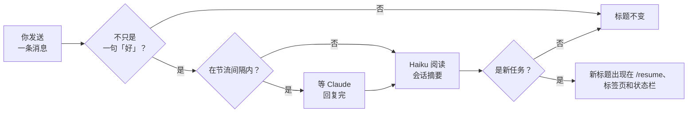

# Live Title

**让 Claude Code 的会话标题跟上你手头的工作。**

Claude Code 根据你的第一条消息给会话起名，之后就一直用这个名字。Live Title 会在工作转向新任务时给会话改名，让终端标签页、状态栏和 `/resume` 里显示的，始终是这个会话**现在**在做的事。

[](https://github.com/macworld/claude-live-title/releases)
[](LICENSE)
[](https://github.com/macworld/claude-live-title/stargazers)

[English](README.md) | 中文


## 为什么需要它

会话总会跑题。你打开一个会话去查订单列表的分页 Bug，一小时后已经在把所有列表接口改成游标分页，可会话名还停在那个 Bug 上。几个这样的会话开在不同标签页里，只能挨个点开猜哪个是哪个。

| 你说的话 | Claude Code 的标题 | Live Title |
|---|---|---|
| 用户反馈订单列表翻到第二页，会看到和第一页重复的订单，帮我查一下 | 订单列表分页重复订单 | 订单列表翻页重复问题排查 |
| 干脆把所有列表接口都改成游标分页吧 | 订单列表分页重复订单 | 所有列表接口改用游标分页 |
| 好，开始吧 | 订单列表分页重复订单 | 所有列表接口改用游标分页 |

任务变了，标题跟着变；只回一句“好，开始吧”，标题保持不动。表格和演示里的每个标题，都是 Claude Code 和 Live Title 针对这些消息实际生成的。演示里的状态栏是 [Claude HUD](#配合-claude-hud-使用)。

## 特性

- **跟着任务走，而不是第一条消息。** 从修一个 Bug 开始，转去做一次重构，标题也跟着转。追问、修补、一句“好，继续”，都不会让标题被改写。
- **有了任务才起名。** 打个招呼或发条测试消息，会话先不命名，等你提出要做的事再起。
- **自定义命名格式。** 工单号开头、`fix:` / `feat:` 前缀，团队习惯什么就用什么。用一句话描述即可，全局生效，也可以[按项目设置](#命名格式)。
- **多语言。** 默认用你说话的语言，也可以指定。
- **只听你说的话。** 后台任务通知、子 agent 的回报、压缩摘要都不算；用 `/rename` 或 `--name` 命名过的会话，插件不会再动。
- **不打扰你。** 标题由一次小小的 Haiku 调用在后台生成，每次约 $0.0005。账号用量到达上限或 API 出错时什么都不写，插件暂停一会儿再试。

## 安装

在 Claude Code 里运行：

```
/plugin marketplace add macworld/claude-live-title
/plugin install live-title@claude-live-title
```

然后重启 Claude Code。Hook 只在启动时加载，`/reload-plugins` 不够。这样就装好了，不需要任何配置。

插件名是 `live-title`，仓库和 marketplace 还沿用旧名 `claude-live-title`。

**从 Anthropic 社区目录安装。** Live Title 也收录在 [`claude-plugins-community`](https://github.com/anthropics/claude-plugins-community) 里，用的是旧名。新版本要先通过 Anthropic 的审核才会进入目录，所以那边可能比本仓库落后几个版本。

```
/plugin marketplace add anthropics/claude-plugins-community
/plugin install claude-live-title@claude-community
```

**系统要求：** Claude Code 2.1 或更高版本、`jq`，以及 Linux 或 macOS。Windows 用户请使用 WSL。

<details>
<summary><strong>从 <code>claude-live-title</code>（2.0 之前）升级</strong></summary>

插件在 2.0 从 `claude-live-title` 改名为 `live-title`。用 `--keep-data` 卸载旧插件，安装新插件，然后重启。配置和各会话的标题都会带过来。

```bash
claude plugin uninstall claude-live-title@claude-live-title --keep-data
claude plugin marketplace update claude-live-title
claude plugin install live-title@claude-live-title
```

如果当初是从社区目录安装的，不用重装：那边的条目还是旧名。

</details>

<details>
<summary><strong>Linux 上安装报 <code>EXDEV: cross-device link not permitted</code></strong></summary>

很多 Linux 系统的 `/tmp` 是独立的 tmpfs，会导致插件安装失败。启动 Claude Code 时把 `TMPDIR` 指到 home 目录下：

```bash
mkdir -p ~/.cache/tmp && TMPDIR=~/.cache/tmp claude
```

然后在这个会话里执行上面的安装命令。

</details>

## 标题显示在哪里

- **`/resume`** 按标题列出以前的会话。
- **终端标签页。** Claude Code 会把会话标题设为终端标题（在 tmux 里是 pane 标题），不用额外设置。
- **你的状态栏。** Claude Code 会把标题作为 `session_name` 传给状态栏命令。最简单的显示方式，写在 `~/.claude/settings.json` 里：

  ```json
  {
    "statusLine": {
      "type": "command",
      "command": "jq -r '.session_name // empty'"
    }
  }
  ```

- **[Claude HUD](#配合-claude-hud-使用)**，如果你在用的话。

标签页和状态栏要等你发下一条消息时才换上新标题，因为 Claude Code 只在这个时机接受插件给的标题。插件的第一个标题到来之前，它们显示 Claude Code 自己起的标题。`/clear` 之后，你的第一条消息会先顶替标题，等你发下一条消息时再换成生成的标题。

### 配合 Claude HUD 使用

[Claude HUD](https://github.com/jarrodwatts/claude-hud) 可以在它的状态栏里显示会话标题，就像上面的演示。这个选项默认关闭。

1. 安装 Claude HUD：

   ```
   /plugin marketplace add jarrodwatts/claude-hud
   /plugin install claude-hud
   ```

2. 运行 `/claude-hud:configure`，打开 `showSessionName`。也可以直接在 `~/.claude/plugins/claude-hud/config.json` 里设置：

   ```json
   {
     "display": {
       "showSessionName": true
     }
   }
   ```

3. 开一个新会话。状态栏会显示会话标题，并随工作推进更新。

## 配置

所有配置都是可选的，多数人只会设 `language` 或 `style`。运行 `/live-title:config`，直接说你想改什么就行；也可以编辑插件数据目录里的 `config.json`。目录名取决于你从哪个 marketplace 安装，例如：

```
~/.claude/plugins/data/live-title-claude-live-title/config.json
```

| 设置 | 默认值 | 作用 |
|---|---|---|
| `language` | `"auto"` | 标题语言。`"auto"` 用你消息的语言，即使代码和 Claude 的回复是英文。也可以指定 `"zh"`、`"en"`、`"ja"`、`"ko"` 等 |
| `style` | `""` | 你的命名规则，用自然语言写。见[命名格式](#命名格式) |
| `maxLength` | `30` | 标题最大显示宽度（列），CJK 字符算 2 列 |
| `liveUpdate` | `true` | 设为 `false` 时，每个会话只起一次标题，之后不再改 |

配置文件里只需要写你要改的项。比如你用英文和 Claude 交流，但希望标题用中文：

```json
{
  "language": "zh"
}
```

<details>
<summary><strong>高级设置</strong></summary>

| 设置 | 默认值 | 作用 |
|---|---|---|
| `model` | `"haiku"` | 生成标题用的模型 |
| `throttleInterval` | `60` | 你连续发消息时，两次更新之间至少间隔多少秒。被跳过的消息会在 Claude 回复后补上 |
| `contextMessages` | `{"head": 1, "tail": 5}` | 模型能看到你最早和最近的几条消息 |
| `debug` | `false` | 在插件数据目录写调试日志。配置里有插件不认识的项时，日志会指出来 |

</details>

### 命名格式

默认的标题是一个简短的短语。想要固定格式，就在 `style` 里描述它：

```json
{
  "style": "标题格式：「模块：做什么」，比如「订单：导出按钮无响应」。"
}
```

规则用中文或英文写都可以。比如这一条：

```json
{
  "style": "Start the title with the ticket ID in square brackets, like [PROJ-123], when the user mentions one."
}
```

`PROJ-1423: the login form accepts an empty password, fix it` 得到的标题是 `[PROJ-1423] Fix empty password`。

另一条好用的规则：

```
Begin the title with one of feat:, fix:, docs:, refactor:, chore: and then a short lowercase summary.
```

只想给某个项目设规则，就写在项目根目录的 `.claude/live-title.md` 里。它会在这个项目的会话中取代 `style`，提交到仓库后整个团队用同一种格式。规则最长 1000 个字符，`maxLength` 照样生效。

## 工作原理



你每发一条消息，Haiku 会拿到一份简短的会话摘要：当前标题、你的第一条消息、最近几条消息，以及 Claude 最新回复的摘录。只要你还在朝同一个目标工作，它就保留原标题；换了方向，才写一个新的。标题在 Claude 回复的同时在后台生成，每 `throttleInterval` 秒最多一次，被跳过的消息会在回复结束后补上。模型不带任何工具，并且只把对话当作要起标题的材料，从不当作指令，所以你贴进会话的提示词左右不了标题。

<details>
<summary><strong>更多细节</strong></summary>

插件用三个 hook：

1. **你发送消息时**（UserPromptSubmit，异步）。在 Claude 回复的同时生成新标题，每 `throttleInterval` 秒最多一次。
2. **每次回复结束后**（Stop，异步）。会话还没有标题时起一个；补上被节流跳过的消息；上次检查已超过 15 分钟时再复查一次，让长时间的自主运行保持准确；如果 Claude Code 写回了旧标题，就恢复成最新的。
3. **标题同步**（UserPromptSubmit，同步）。Claude Code 自己保留一份标题：标签页和状态栏显示的是这一份，它也会被写回 transcript。这个 hook 通过官方的 `sessionTitle` 字段把最新标题交给 Claude Code，让两边保持一致。它不调用模型，大约 20 ms 完成。

模型看到的内容：

- **`CURRENT_TITLE`**：当前显示的标题。只要目标没变就原样保留，标题不会来回变。
- **`FIRST`**：你的第一条消息，用来理解后面简短的跟进。
- **`EARLIER`**：最新一条之前的几条近期消息（最多 `contextMessages.tail` 条）。
- **`LATEST`**：你的最新一条消息，最重要的信号。
- **`CLAUDE`**：Claude 最新回复的摘录，作为背景。

过长的消息只保留开头和结尾。Claude 的回复会先清洗：去掉代码块、行内代码、堆栈帧和 shell 提示符行（规则在 `hooks/lib/sanitize-line-rules.tsv`），剩下的文字太少就整段不用。如果还没有任务（打招呼、测试消息、闲聊），模型回答 `SKIP`，什么都不写。模型调用通过 `claude -p` 进行，不带工具、不保存会话，一次生成最多花 60 秒调用模型。如果返回的标题超过 `maxLength`，最多再调用两次让它缩短。结果作为 `custom-title` 记录写入 transcript。

</details>

## 常见问题

**会拖慢 Claude Code 吗？**
不会。标题在后台生成。唯一同步运行的 hook 不调用模型，大约 20 ms 完成。

**要花多少钱？**
每个标题是一次 Haiku 调用，输入约 1.6K token，按 API 价格大约 $0.0005。它和 Claude Code 用同一个登录，所以在 Pro 或 Max 订阅下，会像其他请求一样计入你的套餐用量。

**哪些数据会离开我的电脑？**
只有生成标题的那次调用，它和其他 Claude Code 请求一样，通过 `claude -p` 发给 Anthropic。插件不收集任何统计数据。详见[隐私政策](PRIVACY.md)。

## 故障排查

**会话没有标题。**
打招呼或测试消息不会生成标题，你提出要做的事之后，会话才会命名。

**完全看不到标题。**
1. 确认插件已安装并启用：已启用插件列表里应该有 `live-title`。
2. 安装或更新后重启 Claude Code。Hook 只在启动时加载。
3. 在配置中设置 `"debug": true`，然后查看 `~/.claude/plugins/data/live-title-*/debug.log`。

**某个会话不再更新了。**
- 如果你给它改过名（`/rename`、`--name`），插件会刻意保留你的名字。
- 遇到用量上限后插件会暂停 10 分钟（其他错误暂停 2 分钟），避免反复撞上限。

**标题语言不对。**
在配置中设置 `language`。

**遇到了离谱的标题？欢迎帮我们改进。**
开启 `"debug": true` 后，每次生成标题都会在调试日志里记下模型真正看到的输入。运行 `bin/promote-fixture.sh <slug>` 可以把最近一条固化成 `tests/fixtures/transcripts/` 下的回归 fixture，附在 issue 或 PR 里提交即可。

## 开发

```bash
git clone https://github.com/macworld/claude-live-title
cd claude-live-title

# 直接从工作目录加载插件
claude --plugin-dir .
```

`--plugin-dir` 不经过安装和插件缓存。修改 hook 需要重启会话；修改 command/skill 可以用 `/reload-plugins` 重载。

运行测试：

```bash
for t in tests/test-*.sh; do bash "$t"; done

# 再用真实模型检查 fixture（每次大约一美分）
RUN_LIVE=1 bash tests/test-fixtures.sh

# 每个 fixture 跑 4 次，抓出偶尔才出错的标题
RUN_LIVE=1 SAMPLES=4 bash tests/test-fixtures.sh
```

## 更多

- [更新日志](CHANGELOG.md)：版本记录和发布说明
- [隐私政策](PRIVACY.md)：哪些在本地运行，哪些会离开你的机器

## 许可证

MIT
