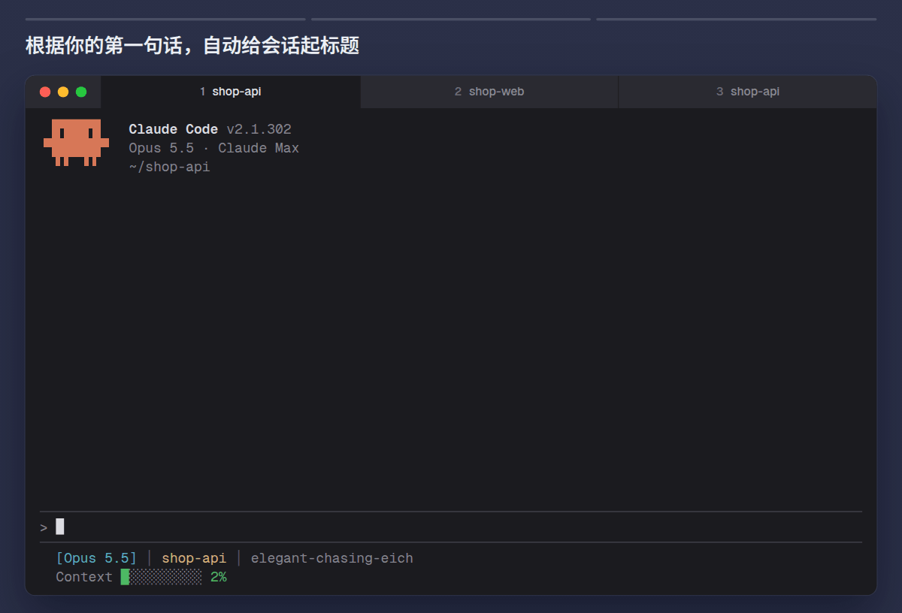
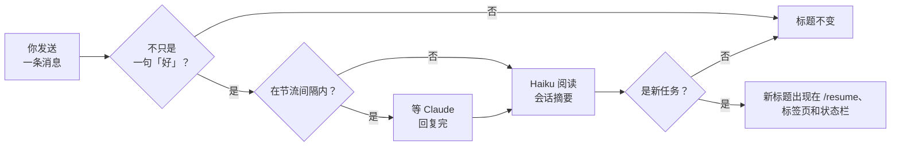

# Live Title

Live Title 是一个 Claude Code 插件，自动为会话生成标题，并在任务变化时更新标题。标题显示在终端标签页、状态栏和 `/resume` 列表中。

[](https://github.com/macworld/claude-live-title/releases)
[](LICENSE)
[](https://github.com/macworld/claude-live-title/stargazers)

[English](README.md) | 中文



## 为什么需要它

1. **同时开着多个会话。** 几个会话各自处理不同的任务，隔一段时间再回来，或者在会话之间来回切换，很容易忘了某个会话在做什么。这时需要标题来提醒你。
2. **一个会话里的任务会变。** 同一个会话用得久了，讨论的内容和目标常常会转移或调整。Claude Code 只根据第一条消息起一次标题，之后不再更新，标题就和实际在做的事对不上了。Live Title 会在任务变化时更新标题。

例如下面这个会话，一开始在排查订单列表的分页 Bug，后来变成了把所有列表接口改成游标分页：

| 你的消息 | Claude Code 的标题 | Live Title 的标题 |
|---|---|---|
| 用户反馈订单列表翻到第二页，会看到和第一页重复的订单，帮我查一下 | 订单列表分页重复订单 | 订单列表翻页重复问题排查 |
| 干脆把所有列表接口都改成游标分页吧 | 订单列表分页重复订单 | 所有列表接口改用游标分页 |
| 好，开始吧 | 订单列表分页重复订单 | 所有列表接口改用游标分页 |

第二条消息换了任务，标题随之更新；第三条只是确认，标题不变。表格和演示中的标题都是实际生成的结果。演示里的状态栏是 [Claude HUD](#配合-claude-hud-使用)。

## 功能

- 只要还在做同一件事，标题就保持不变。追问、小修改、“好，继续”这类回复不会改动标题。
- 有了具体任务才起标题。打招呼、测试消息不会生成标题。
- 支持自定义命名格式，用自然语言描述即可，比如工单号开头、加 `fix:` / `feat:` 前缀。可以全局设置，也可以[按项目设置](#命名格式)。
- 标题默认和你消息的语言一致，也可以指定语言。
- 只看你自己发的消息。后台任务通知、子 agent 返回的结果、上下文压缩摘要都不计入。用 `/rename` 或 `--name` 命名过的会话会保留你起的名字。
- 在后台运行，不影响 Claude Code 的速度。每个标题是一次 Haiku 调用，约 $0.0005。遇到用量上限或 API 报错时不写入标题，插件暂停几分钟后再试。

## 安装

在 Claude Code 中运行：

```
/plugin marketplace add macworld/claude-live-title
/plugin install live-title@claude-live-title
```

然后重启 Claude Code。Hook 只在启动时加载，只执行 `/reload-plugins` 不会生效。装好后无需配置即可使用。

插件名是 `live-title`，仓库和 marketplace 仍沿用旧名 `claude-live-title`。

也可以从 Anthropic 的社区目录 [`claude-plugins-community`](https://github.com/anthropics/claude-plugins-community) 安装，那里用的是旧名。新版本要经过 Anthropic 审核才会进入社区目录，所以那里的版本可能比本仓库落后几个。

```
/plugin marketplace add anthropics/claude-plugins-community
/plugin install claude-live-title@claude-community
```

**系统要求：** Claude Code 2.1 或更高版本、`jq`，Linux 或 macOS。Windows 请使用 WSL。

<details>
<summary><strong>从 <code>claude-live-title</code>（2.0 之前）升级</strong></summary>

插件在 2.0 版本中从 `claude-live-title` 改名为 `live-title`。先用 `--keep-data` 卸载旧插件，再安装新插件，然后重启。配置和已有会话的标题都会保留。

```bash
claude plugin uninstall claude-live-title@claude-live-title --keep-data
claude plugin marketplace update claude-live-title
claude plugin install live-title@claude-live-title
```

如果是从社区目录安装的，不需要任何操作，那里的条目仍然使用旧名。

</details>

<details>
<summary><strong>Linux 上安装报 <code>EXDEV: cross-device link not permitted</code></strong></summary>

很多 Linux 系统的 `/tmp` 是单独的 tmpfs 文件系统，插件安装会因此失败。启动 Claude Code 时把 `TMPDIR` 指向 home 下的一个目录：

```bash
mkdir -p ~/.cache/tmp && TMPDIR=~/.cache/tmp claude
```

然后在这个会话中运行安装命令。

</details>

## 标题显示在哪里

- **`/resume`**：按标题列出历史会话。
- **终端标签页**：Claude Code 会把会话标题设为终端标题（tmux 中是 pane 标题），无需额外设置。
- **状态栏**：Claude Code 会把标题作为 `session_name` 传给状态栏命令。只显示标题的最简配置，写在 `~/.claude/settings.json` 中：

  ```json
  {
    "statusLine": {
      "type": "command",
      "command": "jq -r '.session_name // empty'"
    }
  }
  ```

- **[Claude HUD](#配合-claude-hud-使用)**，如果你在用它。

标签页和状态栏要等你发出下一条消息时才会换成新标题，因为 Claude Code 只在这个时机接受插件提供的标题。插件生成第一个标题之前，显示的是 Claude Code 自己起的标题。执行 `/clear` 后，会先用你的第一条消息作为临时标题，等你发下一条消息时再换成生成的标题。

### 配合 Claude HUD 使用

[Claude HUD](https://github.com/jarrodwatts/claude-hud) 可以在状态栏中显示会话标题，也就是上面演示中的效果。这个选项默认关闭。

1. 安装 Claude HUD：

   ```
   /plugin marketplace add jarrodwatts/claude-hud
   /plugin install claude-hud
   ```

2. 运行 `/claude-hud:configure`，打开 `showSessionName`；也可以直接在 `~/.claude/plugins/claude-hud/config.json` 中设置：

   ```json
   {
     "display": {
       "showSessionName": true
     }
   }
   ```

3. 新开一个会话，状态栏就会显示会话标题。

## 配置

所有设置都是可选的。运行 `/live-title:config`，直接说明要查看或修改什么；也可以编辑插件数据目录下的 `config.json`。目录名取决于你从哪个 marketplace 安装，例如：

```
~/.claude/plugins/data/live-title-claude-live-title/config.json
```

| 设置 | 默认值 | 作用 |
|---|---|---|
| `language` | `"auto"` | 标题语言。`"auto"` 跟随你消息的语言，即使代码和 Claude 的回复是英文也一样。也可以指定 `"zh"`、`"en"`、`"ja"`、`"ko"` 等 |
| `style` | `""` | 命名规则，用自然语言描述。见[命名格式](#命名格式) |
| `maxLength` | `30` | 标题最大显示宽度（列），中日韩字符按 2 列计算 |
| `liveUpdate` | `true` | 设为 `false` 后，每个会话只起一次标题，之后不再更新 |

配置文件里只需写要修改的项。比如你用英文和 Claude 交流，但希望标题用中文：

```json
{
  "language": "zh"
}
```

<details>
<summary><strong>高级设置</strong></summary>

| 设置 | 默认值 | 作用 |
|---|---|---|
| `model` | `"haiku"` | 生成标题使用的模型 |
| `throttleInterval` | `60` | 连续发消息时，两次更新之间的最短间隔（秒）。因节流被跳过的消息会在 Claude 回复后补上 |
| `contextMessages` | `{"head": 1, "tail": 5}` | 模型能看到你最早的几条和最近的几条消息 |
| `debug` | `false` | 在插件数据目录中写调试日志。配置里有插件无法识别的设置项时，日志中会列出 |

</details>

### 命名格式

默认的标题是一个简短的短语。如果需要固定格式，在 `style` 中描述即可：

```json
{
  "style": "标题格式：「模块：做什么」，比如「订单：导出按钮无响应」。"
}
```

规则用中文或英文写都可以。例如：

```json
{
  "style": "Start the title with the ticket ID in square brackets, like [PROJ-123], when the user mentions one."
}
```

按这条规则，`PROJ-1423: the login form accepts an empty password, fix it` 的标题是 `[PROJ-1423] Fix empty password`。

再比如：

```
Begin the title with one of feat:, fix:, docs:, refactor:, chore: and then a short lowercase summary.
```

如果只想对某个项目生效，把规则写在项目根目录的 `.claude/live-title.md` 中。这个文件会在该项目的会话中取代 `style`，提交到仓库后，团队成员都会使用同一种格式。规则最长 1000 个字符，`maxLength` 依然生效。

## 工作原理



每次你发送消息，Haiku 会收到一份精简的会话内容：当前标题、你的第一条消息、最近几条消息，以及 Claude 最新回复的摘录。如果你还在做同一件事，它保留原标题；目标变了，才写新标题。标题在后台生成，和 Claude 的回复同时进行，每 `throttleInterval` 秒最多生成一次；被节流跳过的消息会在回复结束后补上。生成标题的调用不带任何工具，模型也被要求不执行对话中的请求、不回答其中的问题，只负责起标题。

<details>
<summary><strong>更多细节</strong></summary>

插件使用三个 hook：

1. **发送消息时**（UserPromptSubmit，异步）：在 Claude 回复的同时生成新标题，每 `throttleInterval` 秒最多一次。
2. **每次回复结束后**（Stop，异步）：会话还没有标题时起一个，并处理被节流跳过的消息。距上次检查超过 15 分钟时会重新检查一次，避免长时间自主运行的会话标题过时。如果 Claude Code 写回了旧标题，就恢复为最新标题。
3. **标题同步**（UserPromptSubmit，同步）：Claude Code 自己保存一份标题，标签页和状态栏显示的是这一份，Claude Code 也会把它写回 transcript。这个 hook 通过官方的 `sessionTitle` 字段把最新标题交给 Claude Code，让两边保持一致。它不调用模型，耗时约 20 ms。

模型看到的内容：

- **`CURRENT_TITLE`**：当前标题。只要目标没变就保留，避免标题频繁变动。
- **`FIRST`**：你的第一条消息，用来理解后面简短的跟进消息。
- **`EARLIER`**：最新一条之前的几条消息（最多 `contextMessages.tail` 条）。
- **`LATEST`**：你的最新一条消息，判断时最重要的依据。
- **`CLAUDE`**：Claude 最新回复的摘录，作为背景参考。

过长的消息只保留开头和结尾。Claude 的回复会先经过清洗：去掉代码块、行内代码、堆栈帧和 shell 提示符行（规则见 `hooks/lib/sanitize-line-rules.tsv`），清洗后剩下的文字太少就整段不用。如果还没有任务（打招呼、测试消息、闲聊），模型返回 `SKIP`，不写入标题。模型通过 `claude -p` 调用，不带工具、不保存会话，一次运行在模型调用上最多花 60 秒。如果返回的标题超过 `maxLength`，最多再调用两次要求缩短。结果以 `custom-title` 记录写入 transcript。

</details>

## 常见问题

**会拖慢 Claude Code 吗？**
不会。标题在后台生成。唯一同步运行的 hook 不调用模型，耗时约 20 ms。

**费用是多少？**
每个标题是一次 Haiku 调用，输入约 1.6K token，按 API 价格约 $0.0005。调用使用和 Claude Code 相同的登录，所以在 Pro 或 Max 订阅下，它和其他请求一样计入套餐用量。

**哪些数据会离开本机？**
只有生成标题的那次调用。它和其他 Claude Code 请求一样，通过 `claude -p` 发给 Anthropic。插件不收集任何统计数据。详见[隐私政策](PRIVACY.md)。

## 故障排查

**会话没有标题。**
打招呼和测试消息不会生成标题，你提出具体任务后才会起标题。

**完全看不到标题。**
1. 确认插件已安装并启用：已启用的插件中应该有 `live-title`。
2. 安装或更新后重启 Claude Code，hook 只在启动时加载。
3. 在配置中设置 `"debug": true`，然后查看 `~/.claude/plugins/data/live-title-*/debug.log`。

**某个会话的标题不再更新。**
- 如果你手动改过名（`/rename`、`--name`），插件不会再改动它。
- 遇到用量上限后插件会暂停 10 分钟（其他错误暂停 2 分钟），避免反复触发上限。

**标题语言不对。**
在配置中设置 `language`。

**反馈不合适的标题。**
开启 `"debug": true` 后，每次生成标题都会在调试日志里记录模型实际看到的输入。运行 `bin/promote-fixture.sh <slug>` 可以把最近一条记录转成 `tests/fixtures/transcripts/` 下的回归 fixture，附在 issue 或 PR 中提交。

## 开发

```bash
git clone https://github.com/macworld/claude-live-title
cd claude-live-title

# 直接从工作目录加载插件
claude --plugin-dir .
```

`--plugin-dir` 会跳过安装步骤和插件缓存。修改 hook 后需要重启会话；修改 command 或 skill 后可以用 `/reload-plugins` 重新加载。

运行测试：

```bash
for t in tests/test-*.sh; do bash "$t"; done

# 再用真实模型检查 fixture（每次约 1 美分）
RUN_LIVE=1 bash tests/test-fixtures.sh

# 每个 fixture 跑 4 次，找出偶尔才出错的标题
RUN_LIVE=1 SAMPLES=4 bash tests/test-fixtures.sh
```

## 更多

- [更新日志](CHANGELOG.md)：各版本的改动
- [隐私政策](PRIVACY.md)：哪些在本地运行，哪些会发给 Anthropic

## 许可证

MIT
